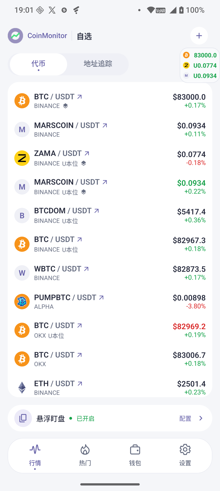
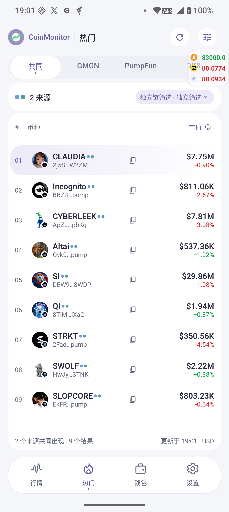
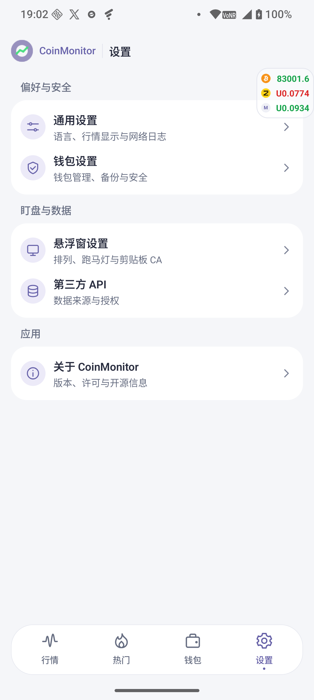

<div align="center">
  
  <h1>CoinMonitor</h1>
  <p>Android 加密货币行情监控，支持自选列表、悬浮盯盘和多链钱包。</p>
  <p><a href="./README.md">English</a> · <a href="https://github.com/baiyanwu/CoinMonitor/releases">下载 APK</a> · <a href="https://github.com/baiyanwu/CoinMonitor/issues">反馈问题</a></p>
</div>

## 界面预览

<table>
  <tr>
    <th>行情与悬浮盯盘</th>
    <th>热门榜单</th>
    <th>设置</th>
  </tr>
  <tr>
    <td></td>
    <td></td>
    <td></td>
  </tr>
</table>

截图来自 Seeker 实机，版本 1.0.14。

## 核心功能

- **自选行情**：统一查看 Binance、OKX 和链上代币，支持搜索、排序、置顶及合约地址复制。
- **悬浮盯盘**：在其他 App 上方查看价格，支持排列面板与跑马灯，可调整透明度、字体和位置。
- **热门发现**：查看 GMGN、PumpFun、OKX 榜单，以及多个来源共同出现的热门代币。
- **快捷查询**：通过剪贴板查询合约地址，快速打开行情网站，并添加地址追踪。
- **多链钱包**：支持 EVM 与 Solana 的本地自托管钱包、资产查询、收款、转账和 DApp 浏览器，也可只读观察其他地址。
- **个性化设置**：支持浅色 / 深色主题、中英文，以及行情来源和刷新设置。

部分数据源与钱包查询需要在「第三方 API」中配置自己的凭证；悬浮盯盘需要授予系统悬浮窗权限。

## 构建

准备 JDK 17、Android SDK 35，可使用 Android Studio 打开项目。App 支持 Android 8.0 及以上。

```bash
git clone https://github.com/baiyanwu/CoinMonitor.git
cd CoinMonitor
```

Wallet Core 依赖通过 GitHub Packages 下载，需要具有 `read:packages` 权限的 GitHub classic PAT。在本机 `~/.gradle/gradle.properties` 中添加（不要提交凭证）：

```properties
gpr.user=YOUR_GITHUB_USERNAME
gpr.key=YOUR_READ_PACKAGES_TOKEN
```

```bash
./gradlew :app:assembleDebug
# 可选：运行测试和静态检查
./gradlew :app:testDebugUnitTest :app:lintDebug
```

APK 位于 `app/build/outputs/apk/debug/`。Release 签名与发布见 [发布说明](./docs/RELEASE.md)。

## 更多文档

[技术说明](./docs/TECHNICAL.md) · [贡献指南](./docs/CONTRIBUTING.md) · [更新记录](./docs/CHANGELOG.md)

## 开源协议

采用 [Apache-2.0](./LICENSE) 协议，第三方依赖见 [第三方声明](./docs/THIRD_PARTY_NOTICES.md)。行情仅供参考，不构成投资建议。
